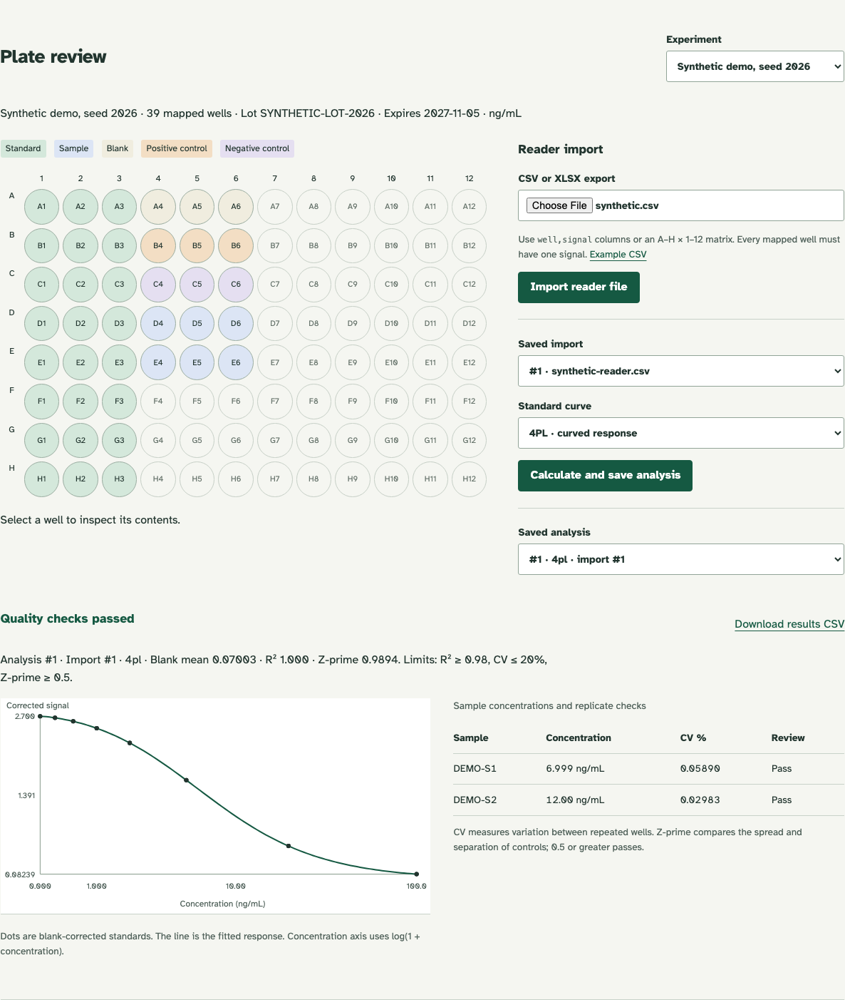

# Lab experiment notebook

I built a lab experiment notebook because I wanted to keep a sample's name, its test results and the materials used for it in one place. Keeping those pieces in separate spreadsheets makes it easy to lose which result belongs to which sample.

The tests in this project use a plastic tray with many small containers, called **wells**. The tray is a **plate**, and a **plate reader** is the device that measures light from each well. An **assay** is the laboratory test being done. I record where each sample goes, import the device's readings, and compare them with samples containing known amounts to calculate the unknown concentrations, or amounts per unit volume.

The page warns me when repeated readings disagree or the control samples do not separate clearly. It keeps the original readings and a history of saved changes. I can also download instructions for an Opentrons OT-2, a robot that moves measured amounts of liquid between containers. My included full-test demonstration uses clearly labelled synthetic data, so it runs without laboratory equipment.

I also wanted to learn how spectrum measurements work. My simulated spectrum analyzer sweeps a signal, finds its strongest frequency, estimates the noise floor, and checks harmonics and unwanted peaks. My hands-on waveform work comes from my NE 241 labs; this analyzer is a software simulation. Run the spectrum command below to save a plot and report.

**Try it locally:** run the commands below, open the page, and click **Open synthetic demo**. The demo has two samples with known answers, 7 and 12 nanograms per millilitre (ng/mL). I can inspect each well, compare the recovered concentrations, download the results, and prepare a robot plan without an instrument or an account.



## Run it

I use Python 3.11 or 3.12 and [uv](https://docs.astral.sh/uv/getting-started/installation/) to install the pinned dependencies.

```sh
git clone https://github.com/jackaI1/lab-assay-lims.git
cd lab-assay-lims
uv sync --locked --extra dev --extra robot
uv run uvicorn lab_assay.app:app --host 127.0.0.1 --port 8000
```

Open <http://127.0.0.1:8000>. Stop the server with Ctrl+C. My records stay in `assays.sqlite`; I can choose another file with the `LIMS_DB` environment variable. This is a local research demonstration with no login, so I keep it bound to this computer.

## Try the other lab exercises

I also use this notebook to practice measurements and plan experiments without needing equipment or biological samples. All of these examples use invented data and demonstration limits.

```sh
# Repeated simulated oscilloscope and optical spectrum captures, with CSV and JSON
uv run python -m lab_assay.instrument --repeats 3 --output instrument-output
# Measure a simulated RF signal and save spectrum.png and report.json
uv run python -m lab_assay.spectrum --output spectrum-output
# Sweep a synthetic power supply over a local network socket
uv run python -m lab_assay.scpi_server --output sweep.csv
# Plan and analyse a simulated thin-film experiment
uv run python -m lab_assay.doe --output doe-output
# Calculate plate counts, monitoring flags and medium volume
uv run python -m lab_assay.microbiology data/synthetic-plates.csv --limit 10000 --environment data/synthetic-environment.csv --limits data/synthetic-limits.json --media-lot DEMO-01 --plates 20 --output microbiology-report.json
```

The spectrum exercise uses a simulated signal source and analyzer, with adjustable frequency, power, sweep range and resolution bandwidth (the width of the analyzer filter). The report shows the median noise floor, peak, second and third harmonics, and strongest other spur compared with a relative power limit. See [measurement details](docs/spectrum.md).

The instrument exercise sends text commands called SCPI to simulated devices using PyVISA. It checks the highest spectral peak, its power and the spacing between the two strongest peaks, and saves settings and repeated readings. The same capture is available at `POST /api/instruments/capture?repeats=3` while the app is running. The deposition exercise changes power, pressure and time together to estimate their effects, interactions and a curved response. The microbiology exercise estimates colony-forming units (CFU) from duplicate plates and flags unusually high environmental counts. These are teaching examples, not validated methods or real equipment results. [Details and assumptions](docs/lab-exercises.md).

## Follow an experiment

1. **Register the materials.** Add a sample ID and description, then a reagent lot with an expiry date.
2. **Save the plate map.** Give the plate a name and concentration unit. Assign wells to blanks, known standards, controls, or registered samples. A sample's dilution factor corrects the concentration back to the original sample.
3. **Import a reader file.** Use CSV or XLSX with `well,signal` columns, or a full 8-by-12 matrix. The file must match the saved map exactly. I provide an [example CSV](data/synthetic-reader.csv) and [map](data/synthetic-map.json).
4. **Calculate and review.** Choose a straight-line or curved standard response. Review the curve, repeated-well variation and control separation. An out-of-range sample stays unreported instead of getting a guessed concentration.
5. **Save the evidence.** Download the results CSV and keep the original import and saved analysis. The history records every registration, import, analysis and protocol generation.

I made saved records immutable: a correction gets a new ID or plate name rather than overwriting an earlier result. Each saved change and its audit entry are written in the same database transaction. The API reference is at `/docs` while the app is running.

## Prepare an OT-2 plan

On the page, I choose **Serial dilution** or **Plate transfers**, enter volumes, and download `assay-protocol.py`. A serial dilution progressively reduces concentration along one row. A transfer plan moves declared volumes from a source plate into an empty destination plate, using a fresh tip for each move.

```sh
uv run opentrons_simulate assay-protocol.py
```

The generator checks pipette limits, well capacity, tip count and source depletion before producing a file. The exported plan lists the deck positions, stock and diluent amounts, and expected final volumes. The web page does **not** run simulation itself; I run the command on the exact exported file. Both protocol types are exercised with the real simulator in the test suite and CI.

I have tested the instructions in software, not on a physical robot. Liquid heights, reservoir dead volume, labware, mixing and calibration still need a bench check. Preparation plans are linked to a plate for traceability, but I do not infer their transfers from the analytical plate map.

## Data and calculations

My default plate is **synthetic**, generated with seed 2026 and known sample concentrations. It includes triplicate standards, blanks, independent controls and diluted samples. The generator can also produce deliberately noisy controls. I use it to test whether the fitted curve recovers the known concentrations within 4%.

I also included 24 public, measured calibration wells from Feng Feng's MIT-licensed **ELISAtools** example. I retained only standards, subtracted the 620 nm reference from the 450 nm signal, and recorded the source commit and file hashes. The public example lacks independent controls and known unknown-sample answers, so I use it to test calibration, not to claim a validated complete assay. [Data provenance and reuse terms](data/README.md).

For a curved response I use a **four-parameter logistic curve (4PL)**: a smooth response with two plateaus, a midpoint and a slope. I support increasing and decreasing responses. **CV%** measures variation between repeated wells, and **Z-prime** measures how clearly positive and negative controls separate. The default review limits are R² ≥ 0.98 for curve fit, CV ≤ 20%, and Z-prime ≥ 0.5. These are demonstration limits, not a validated laboratory acceptance procedure. [Equations, import formats and failure rules](docs/assay-method.md).

## Simulate a population with dementia

I built a small health simulation because I wanted to see how many people might move from healthy ageing into memory problems, dementia and long-term care, and how much the answer depends on the numbers I guess. Health planners use models like this to estimate future care needs before they decide how many beds or staff to plan for.

The model starts with a made-up group of 20,000 people, all aged 65. Each year, each person can stay as they are, develop mild memory problems (mild cognitive impairment), develop dementia, move into long-term care or die. The chance of each change comes from a configuration file. Every number in it is either a published figure with its source, or marked as my assumption.

I tuned the model to two published Canadian figures: 2.4% of people aged 65 to 74 have dementia, and 34.5% of people aged 85 and over do (Canadian Study of Health and Aging, 1991 data). It also matches a Statistics Canada life expectancy of 21 years at age 65, which is an average of the male and female figures. I left out the 75 to 84 group while tuning and check afterwards whether the model lands near it. That target is a rough estimate I worked out from the other two numbers, so it is a sanity check and not a second published result.

```sh
uv run python -m lab_assay.microsim --output microsim-output
```

This writes `microsim-output/report.json` and three plots. With the default settings, a person aged 65 spends about 2.1 years with dementia on average. When I vary the assumptions together, the 95% range is 1.6 to 2.9 years. The tornado plot shows which assumptions change the answer most: how likely people are to die while in long-term care, and how fast dementia starts.

Options: `--population` sets the group size, `--seed` sets the random seed (the same seed gives the same result), `--psa-draws` sets how many sets of assumptions are sampled, and `--config` points to another configuration file. The methods note, with every assumption and limitation, is in [docs/microsim.md](docs/microsim.md).

## Inside the project

- `lab_assay/store.py` keeps related samples, lots, wells, imports, results and audit events in SQLite.
- `lab_assay/app.py` serves the page and FastAPI endpoints, with input validation and download routes.
- `lab_assay/importers.py` reads normalized reader exports; `analysis.py` fits curves and calculates results.
- `lab_assay/protocols.py` produces standalone Opentrons API v2 instructions and volume plans.
- `lab_assay/microsim.py` runs the dementia simulation; its inputs are in `data/microsim/config.json`.
- `lab_assay/static/` contains the page, forms, plate map and curve plot. [API walkthrough](docs/api-example.md).

The audit trail is append-only at the database level, with original import bytes and SHA-256 fingerprints retained. It is not a regulated LIMS: there are no authenticated signatures, access roles, inventory consumption records or protection against a database administrator changing the schema. Each plate references one reagent lot. I also do not estimate concentration uncertainty or support kinetic/multi-wavelength vendor exports directly.

## Checks I run

```sh
uv run pytest -q
uv run ruff check .
uv run ruff format --check .
# Optional real-browser workflow, with its own temporary server and cleanup:
uv sync --locked --extra dev --extra robot --extra browser
uv run playwright install chromium
uv run python scripts/browser_check.py
```

My original assay suite includes **51 tests**, including four real Opentrons simulator runs. The simulation adds **9 tests** in `tests/test_microsim.py`, covering seeded reproducibility, probability conservation, calibration recovery and the command-line tool. They run in the same CI job, with the full suite at 75 tests. The seeded curve recovers 6.9989 and 12.0007 ng/mL for the 7 and 12 ng/mL samples, with Z-prime 0.9894. GitHub Actions runs the same unit and API tests on Python 3.11 and 3.12, plus the browser workflow. Tests cover concentration recovery, public calibration, malformed CSV/XLSX files, invalid record links, immutable history, expired lots, failing controls and impossible liquid transfers. The browser check registers materials, saves a map, imports a plate, calculates results, downloads files and checks desktop/mobile layouts. It closes its browser and temporary server in a `finally` block and checks that the port is closed.


## Other things I've built here

- [android-vitals-viewer](projects/android-vitals-viewer/)
- [calibration-inspection-log](projects/calibration-inspection-log/)
- [cgm-metrics-check](projects/cgm-metrics-check/)
- [clinical-data-sdtm-pipeline](projects/clinical-data-sdtm-pipeline/)
- [clinical-image-quality-gate](projects/clinical-image-quality-gate/)
- [co2-capture-data-analysis](projects/co2-capture-data-analysis/)
- [cpic-guideline-tracker](projects/cpic-guideline-tracker/)
- [drug-release-kinetics-fit](projects/drug-release-kinetics-fit/)
- [ecg-samd-lifecycle](projects/ecg-samd-lifecycle/)
- [eeg-session-qc](projects/eeg-session-qc/)
- [fee-schedule-diff](projects/fee-schedule-diff/)
- [hl7-dicom-gateway](projects/hl7-dicom-gateway/)
- [hpo-phenotype-validator](projects/hpo-phenotype-validator/)
- [lidar-slam-ekf-localization](projects/lidar-slam-ekf-localization/)
- [machine-health-monitor](projects/machine-health-monitor/)
- [ros2-nav2-slam-sim](projects/ros2-nav2-slam-sim/)
- [scpi-bench-automation](projects/scpi-bench-automation/)
- [selenium-test-harness](projects/selenium-test-harness/)
- [tissue-patch-eval](projects/tissue-patch-eval/)
- [titration-curve-analysis](projects/titration-curve-analysis/)
- [trial-criteria-checker](https://github.com/jackaI1/trial-criteria-checker) (in its own repo again; [older copy](projects/trial-criteria-checker/))
- [chart-send-extension](projects/chart-send-extension/)
- [px4-drone-identity](projects/px4-drone-identity/)
- [px4-drone-identity-sitl](projects/px4-drone-identity-sitl/)
- [machine-panel-design](projects/machine-panel-design/)
- [microbiome-qc-report](projects/microbiome-qc-report/)
- [microfluidic-mixing-sim](projects/microfluidic-mixing-sim/)
- [microscopy-count-qc](projects/microscopy-count-qc/)
- [nanoparticle-pk-octave](projects/nanoparticle-pk-octave/)
- [nestjs-supabase-rbac](projects/nestjs-supabase-rbac/)
- [nextjs-clinic-intake](projects/nextjs-clinic-intake/)
- [omics-rag-agent](projects/omics-rag-agent/)
- [openusd-factory-cell](projects/openusd-factory-cell/)
- [php-mysql-test-log](projects/php-mysql-test-log/)
- [post-market-surveillance-trending](projects/post-market-surveillance-trending/)
- [radionuclide-batch-timing](projects/radionuclide-batch-timing/)
- [robot-aws-telemetry](projects/robot-aws-telemetry/)
- [robot-cluster-scheduler](projects/robot-cluster-scheduler/)

- [java-lab-results-service](projects/java-lab-results-service/)
- [plc-control-panel-design](projects/plc-control-panel-design/)
