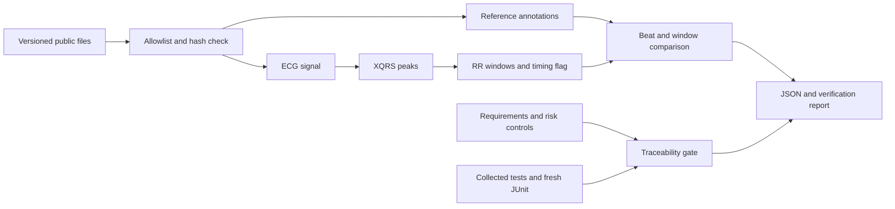

# Architecture and outside-software review

## Components and interfaces

`data.py` resolves only the three allowed record IDs and verifies `.hea`, `.dat` and `.atr` SHA-256 digests before returning a local record path. Versioned HTTPS downloads go to the ignored cache. `manifest.json` is the controlled dataset baseline, not a list of patient identities. A new input requires a reviewed manifest change.

`core.py` validates a one-dimensional signal and calls WFDB XQRS. `detect_peaks(signal, fs)` returns sample indices. It does not accept annotations. `screen_windows(peaks, fs, n_samples)` returns timing features and one of three statuses. It includes no diagnosis, network operation or treatment logic.

`evaluate.py` reads reference annotations after the record is available and compares them with independent detections. It owns beat counts, rhythm-duration labels, abstention accounting and strict JSON serialization. `cli.py` exposes evaluation, warnings and failure exit codes. JSON output is written by replacing a temporary file only after the evaluation succeeds. On failure a pre-existing output file remains the previous run, not a new successful result; always check the exit status.

`scripts/traceability.py` reads controlled requirements/risk links, actual pytest collection and a JUnit execution result. It fails when a requirement/control has no test, a test is absent or not passed, IDs collide, risk controls are empty or requirement links are absent/unknown. It rejects any skip or failure in the full run. It checks completeness, not assertion quality or clinical adequacy. A hand-edited or stale JUnit file is not trustworthy evidence: the canonical `scripts.verify` command deletes old outputs and executes the current tests before checking links.

`scripts/verify.py` runs the full suite, validates trace links, evaluates all three full records again, checks regression floors and generates evidence tied to the revision, environment and CI run. CI diffs the generated matrix against the committed baseline. JUnit, reports and raw data are build artifacts; no long-running service is needed.

## SOUP baseline

SOUP means software of unknown provenance. I use this review to track external components whose full development evidence I do not control. The table is a learning exercise, not supplier qualification. Direct runtime versions are pinned in `pyproject.toml`; every resolved dependency and distribution hash is locked in `uv.lock`. Python is constrained to 3.12.x; the exact patch is captured per run.

| Component | Version | Purpose | Failure concern and check |
| --- | --- | --- | --- |
| Python | 3.12.x | Runtime, JSON, HTTPS, XML | Runtime/platform differences; report exact version and run CI on Linux plus local Mac verification |
| WFDB | 4.3.1 | Read MIT-BIH, XQRS detector | Missed/spurious peaks or annotation interpretation; real-record integration, independent metrics, symbol and rhythm tests |
| NumPy | 2.2.6 | RR calculations and arrays | Units, nonfinite propagation, statistical convention; hand-calculated timing and rejection tests |
| SciPy | 1.16.3 | XQRS filters and peak processing | Filtering/platform changes; QRS integration floors. SciPy 1.15.3 wheel fails to load on this Mac's macOS 27; 1.16.3 passes the tested import and pipeline |
| pandas | 2.2.3 | WFDB annotation tables | Dependency compatibility; pinned to avoid unreviewed major-version API changes; full annotation reads exercised |
| pytest | 8.4.2 | Test execution and JUnit | Missing/skipped tests treated as verification; negative gate tests and fresh full execution |
| Hatchling | 1.27.0 | Build/install package | Missing packaged resources; integration exercises installed entry point and manifest |
| uv | CI 0.12.19 | Locked environment install | Dependency drift; `uv sync --frozen`, lockfile hash in report |

WFDB also pulls dependencies such as requests, aiohttp, matplotlib and soundfile. They are enumerated exactly in `uv.lock`, including artifact hashes. Not all are called directly by this CLI. Review the lockfile diff on any upgrade and regenerate the full evidence; pinning does not mean vulnerability-free. No known-anomaly search or clinical supplier assurance is claimed. See [WFDB's processing API](https://wfdb.readthedocs.io/en/latest/processing.html) for XQRS and annotation-comparison context.

## Trust and resource boundaries

There is no web server, patient upload, database, model training or external service account. The only network input during evaluation is the allowlisted public dataset. Results contain aggregate counts and window timings, not ECG waveforms or subject metadata. Tests use temporary directories and finite subprocess timeouts. The project launches no browser or persistent worker. Normal cleanup is removing `build/` and `.cache/mitdb/` if their artifacts are no longer wanted.
