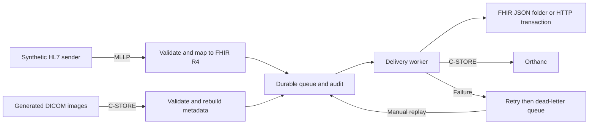

# Gateway design

The gateway is a local integration lab with two ingress paths and one SQLite outbox. It deliberately accepts a small documented profile, rather than guessing how to interpret every message or image.

## Message profile

UTF-8 input, `|^~\&` delimiters, carriage-return segments (LF and CRLF are normalized), HL7 versions 2.5 and 2.5.1. MSH-3/4 identify sender and facility, MSH-7 is a seconds-precision timestamp, MSH-9 is the event, MSH-10 is a 1 to 100 character control ID using letters, numbers, underscore, dot, colon, or hyphen. Accepted IDs are preserved exactly in acknowledgements. MSH-12 supplies the version. One PID is required. This is structural and mapping validation for this profile, not validation against the entire HL7 specification.

| Input | Meaning and output |
| --- | --- |
| ADT A01, A08, A03 | Admit, update, discharge; Patient and Encounter |
| PID-3 | One patient ID with assigning authority in component 4; no repetitions |
| PID-5, PID-7, PID-8 | Family/given names, optional YYYYMMDD birth date, M/F/O/U gender |
| PV1-2, PV1-19 | I/O/E encounter class and required visit ID |
| ORU R01 | Lab results; Patient plus DiagnosticReport per OBR and Observation per OBX |
| OBR-3, OBR-4, OBR-7, OBR-25 | Required filler order ID and code, optional timestamp, required result status |
| OBX-2/3/4/5/6/11/14 | NM/ST/TX type, code, sub-ID, single value, units, status, optional timestamp |
| Result status F/P/C/X | Final, preliminary, corrected, cancelled |
| Coding system LN / UCUM | LOINC / Unified Code for Units of Measure; others use a local code namespace |

OBX must follow its OBR. Empty orders, repeated order identities, repeated observation code/sub-ID within an order, unknown result types/statuses, and nonfinite numeric values are rejected. Standard delimiter escapes F/S/R/T/E are decoded in text fields. Fields outside the table are not mapped; reference ranges, abnormal flags, notes, addresses, and other clinical context are outside this profile. Do not use it for clinical decisions. Timestamps without offsets are interpreted as UTC. Calendar dates and FHIR resources are validated before acceptance, using the R4 models in `fhir.resources` 6.5.0.

Patient IDs are stable SHA-256 identifiers scoped by sending facility, assigning authority, and MRN. Encounter IDs use facility, authority, and visit ID. Report IDs use patient scope and filler order ID; observations add coding system, code, and sub-ID. Display labels do not change record identity. Identity components use unambiguous structured serialization. Resources use PUT requests with relative URLs and resolvable same-bundle references. Repeated updates replace the same resource rather than creating another. Different observations with the same code need distinct OBX-4 sub-IDs. A facility must use unique visit and filler-order IDs within the documented scope.

## Wire acceptance and durability

MLLP frames start with VT (`0b`) and end with FS CR (`1c 0d`). The receiver handles fragmented and multiple frames on a persistent connection. It limits messages to 1 MiB and waits at most ten seconds for each complete frame. Invalid or oversized frames close the connection. Invalid messages get AE; control-ID conflicts and storage failures get AR. AA is sent after the queue and audit insert commit.

The deduplication key includes sender, facility, and message control ID. Reusing it with different raw bytes is a conflict, even if mapping would produce the same records. An exact replay returns AA without making a new job. A retransmission of a dead job stays dead; the operator must explicitly replay it. Use a new control ID for a new update.

The image receiver returns C-STORE success only after de-identified file bytes and an audit event commit together. Duplicate image instance IDs with identical rebuilt bytes do not create another job; different rebuilt content using that identity is rejected. The queue contains no original DICOM file.

SQLite uses full synchronous commits and WAL journaling. One serving process holds a file lock per state directory. Claims use a transaction and a 60-second lease; interrupted work is reclaimed when the lease expires, or goes dead when its attempt budget is exhausted. HTTP requests and DICOM operations use bounded timeouts. SIGTERM and Ctrl+C stop ingress, abort open DICOM associations, and finish the current worker operation before exit. A fatal storage error in the worker stops the serving process so a healthy listener cannot hide a dead delivery loop.

The worker delivers at least once. A crash after remote success but before marking completion can repeat the transfer. Stable FHIR resource IDs and DICOM SOP instance IDs make repeats idempotent at the supplied destinations. There is no distributed transaction, no strict ordering across retried messages, and no protection against an older replay overwriting a newer patient update. One state directory is intended for one local learning session. Delivered payloads and audit entries are retained until the owner erases the volume; there is no automatic retention policy.

Transient exceptions and HTTP 408/429/5xx retry up to three total attempts with exponential backoff. Other HTTP 4xx go directly to dead letters. Even HTTP 200 must contain a transaction-response bundle with one successful response per input entry. The local JSON sink writes a temporary file, fsyncs it, then atomically renames it. It is a bundle export, not a FHIR database.

## Image restrictions and de-identification

The receiver accepts CT Image Storage, MR Image Storage, and Secondary Capture Image Storage with implicit or explicit VR little endian, uncompressed monochrome pixels, one sample per pixel, 8 or 16 bits, dimensions up to 4096, up to 128 frames, and at most 16 MiB of pixel data. The pixel length must match the declared layout. Compressed, color, structured report, and other objects are unsupported. `BurnedInAnnotation=NO` and `RecognizableVisualFeatures=NO` must both be present. These declarations are trusted only because the inputs are synthetic; they do not prove real images are safe. The size check runs after pynetdicom receives the dataset, so it is not a network-level memory quota.

`dicom.py` rejects unexpected value representations before rebuilding a fresh dataset containing only structural and numeric image attributes from `IMAGE_TAGS`. This prevents an explicit-VR sender from hiding a sequence in an otherwise allowlisted tag. It preserves pixel bytes, replaces PatientName with ANON, clears birth/study dates and other type-2 identity fields, and discards private tags and all sequences, including nested identities and referenced original objects. Patient ID uses HMAC-SHA256 with issuer scope. Study, series, and instance UIDs become valid `2.25` UIDs derived from the same keyed mapping so a study remains grouped. File metadata is rebuilt to match the replacement SOP instance UID.

The random 32-byte key is created with mode 0600 in the state directory and remains stable across restarts. Back it up with the state if consistent replacement identities matter. Deleting the volume changes future pseudonyms. Neither this key nor runtime state belongs in Git. FHIR data is not de-identified, and image pseudonyms are intentionally not joined to FHIR patients.

This implementation is not a claim of DICOM PS3.15 Basic Application Level Confidentiality Profile conformance. It does not scrub pixels, remove faces, preserve every required CT/MR acquisition attribute, perform a complete IOD conformance check, or implement a clinical security boundary. MLLP and DICOM are unencrypted; the archive is unauthenticated and host ports are loopback-only. Use generated examples on a trusted local computer. Production would need clinical validation, authentication, TLS, secure storage, retention, terminology services, and a reviewed de-identification process.

## Source layout and references

- `hl7.py`: explicit input validation and FHIR R4 mapping.
- `mllp.py`: framing and acknowledgements.
- `store.py`: durable outbox, audit, retry state and replay.
- `dicom.py`: metadata rebuild, C-STORE ingress and egress.
- `delivery.py`: destination handling and delivery outcomes.
- `cli.py`, `demo.py`: lifecycle, inspection, and invented sample traffic.

I followed the [pynetdicom storage examples](https://pydicom.github.io/pynetdicom/stable/examples/storage.html) for network associations and C-STORE responses, the [FHIR R4 transaction specification](https://hl7.org/fhir/R4/http.html#transaction) for transaction bundles, and the [Orthanc container documentation](https://orthanc.uclouvain.be/book/users/docker.html) for configuration. The [DICOM confidentiality standard](https://dicom.nema.org/medical/dicom/current/output/chtml/part15/chapter_E.html) explains why rewriting metadata alone does not establish image anonymity.
