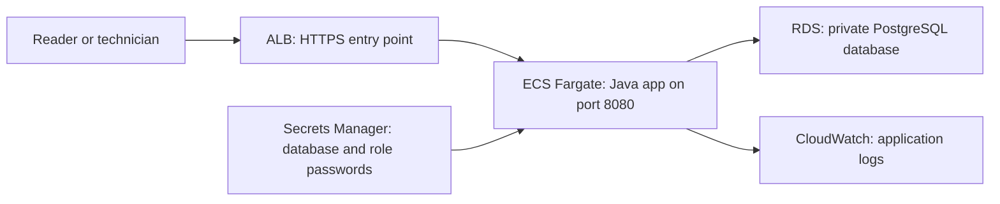

# Running the service as a small cloud stack

I wanted to learn how to move the same lab-result workflow from two local
containers to AWS without paying for a practice account. The app image is the
same multi-stage build I use for each database demo. I use Terraform to describe
the AWS resources, and CI tests that description with a free sandbox.

## Architecture



An ALB, or application load balancer, is the front door that forwards requests
to a healthy app. ECS schedules the app container; Fargate supplies its compute.
RDS supplies the database. Secrets Manager keeps passwords out of the image and
ECS task definition. The task execution role can read only this stack's secret,
and uses the standard ECS execution policy for image pulls and log delivery.
The app does not receive AWS API credentials or an application task role.

Terraform creates a network with two public and two private subnets in separate
availability zones. Security groups, AWS's network access rules, allow only the
ALB to reach app port 8080 and only the app to reach database port 5432. The
database has no public address. The app runs in a public subnet with a public
address for outbound image pulls and AWS API access, avoiding a paid NAT gateway;
its security group still rejects direct inbound requests. For a larger deployment
I would use private tasks with NAT or private AWS endpoints.

The database uses encrypted storage, seven days of backups and deletion
protection outside the sandbox. AWS teardown requires disabling deletion
protection deliberately, and takes a final snapshot. The app uses PostgreSQL TLS
in AWS. The AWS listener requires a regional ACM certificate, uses TLS 1.2/1.3,
and exposes only port 443. Fargate checks `/health`, and the ALB checks it too.
That route is a process check; the HTTP smoke test proves database readiness by
actually recording and correcting a measurement. Failed ECS rollouts use a
circuit breaker with rollback. Logs expire after 14 days.

## What the free sandbox proves

The exact provider versions and image tags are pinned. The image scan also
keeps the Java dependencies current: the app uses Spring Boot 4 and Jackson 3,
while HAPI FHIR retains a separately patched Jackson 2 dependency. The shared
HTTP tests protect the existing input rules during that upgrade. No AWS account,
LocalStack token, card or GitHub secret is needed. This intentionally uses
LocalStack Community 4.12 for IAM, Secrets Manager, STS and CloudWatch Logs, with
Moto 5.1.17 for EC2, ECS, RDS and ELBv2 API state. Current LocalStack ECS and RDS
execution is paid; the free Community image does not run these services. See
[LocalStack's ECS documentation](https://docs.localstack.cloud/aws/services/ecs/)
and [Moto's ECS coverage](https://docs.getmoto.org/en/latest/docs/services/ecs.html).
I do not treat a fake ECS `runningCount` as proof of a working app.

`terraform apply` creates the complete resource graph through those AWS APIs.
`scripts/sandbox-render.py` reads the registered ECS service and task back from
the APIs, verifies the ALB listener/target group and RDS connection wiring, and
resolves the task's password references from **LocalStack Secrets Manager**. It
then writes a private, disposable Compose configuration from that deployed task.
The adapter substitutes the emulated RDS hostname with a real PostgreSQL
container and runs Nginx as the HTTP forwarding stand-in for the ALB. It checks
the task image, port, credentials and health command rather than starting the
separate demo Compose file. The `demo` profile is off: Flyway creates an empty
database, and smoke tests create their own synthetic record.

CI sends ten HTTP checks through this forwarding endpoint: health,
authentication, create, read, reader permissions, correction, stale-revision
conflict, history, FHIR export and invalid input. It restarts the application and
checks that revision 2 and both history values remain in the database. The script
then destroys the Terraform resources and removes its own containers and files.
A `finally`-style shell trap covers failures, with a second workflow cleanup step.

This proves the infrastructure can be applied to emulator APIs and that the
image and deployed configuration work with a real database. It **does not prove**
AWS IAM enforcement, security-group isolation, managed ALB routing/health,
Fargate scheduling, RDS failover, TLS certificates or real AWS availability.
Those need a real AWS staging deployment. The runtime adapter is a test harness,
not a replacement for these AWS services.

## Run the free check

Use a disposable Linux host with Docker Compose 2.24.4+, Python 3, Terraform
1.14 and an internet connection. CI's `deploy-aws-sandbox` job is the easiest way
to run it without building containers on my Mac.

```sh
python3 -m venv .venv
. .venv/bin/activate
pip install boto3==1.40.75
docker build -t lab-results:ci .
./scripts/sandbox.sh
# The script cleans up the running resources, even if an assertion fails.
deactivate
rm -rf .venv infra/.terraform
```

The sandbox owns Compose projects `lab-aws-apis` and `lab-aws-runtime` and
loopback ports 4566, 5000 and 18080. It does not mount the Docker socket into an
emulator or publish the app or database directly. Do not run two sandbox checks
at once on the same host. Files under `.sandbox/`, Terraform state and local
variable files contain generated passwords; they are ignored by Git and never
uploaded as CI artifacts. If the host is forcibly stopped before cleanup, run:

```sh
docker compose -p lab-aws-runtime -f .sandbox/compose.json down -v --remove-orphans
docker compose -p lab-aws-apis -f compose.sandbox.yaml down -v --remove-orphans
rm -rf .sandbox infra/terraform.tfstate* infra/sandbox.auto.tfvars.json
```

## Move the stack to AWS

These steps create **billable resources**. I have tested the free sandbox, not a
live AWS deployment. Keep synthetic data until the identity, privacy and
operational limitations in the main README are addressed.

1. Use an AWS staging account and region with two availability zones. Authenticate
   with AWS SSO (`aws configure sso`, then `aws sso login`) or a short-lived CI OIDC
   role. Never use the sandbox's `test` credentials. Terraform needs permissions
   to manage the listed network, IAM, ECS, RDS, ELB, Logs and Secrets resources.
2. Build the Linux AMD64 image and push it to a private ECR repository. For example,
   after creating `lab-results` in ECR and setting `ACCOUNT` and `AWS_REGION`:

   ```sh
   REGISTRY="$ACCOUNT.dkr.ecr.$AWS_REGION.amazonaws.com"
   aws ecr get-login-password --region "$AWS_REGION" | docker login --username AWS --password-stdin "$REGISTRY"
   docker buildx build --platform linux/amd64 -t "$REGISTRY/lab-results:release-1" --push .
   aws ecr describe-images --repository-name lab-results --image-ids imageTag=release-1 --query 'imageDetails[0].imageDigest' --output text
   ```

   Use the resulting `registry/repository@sha256:...` digest as `TF_VAR_image` so
   a later tag change cannot silently change a deployment. Run the same image
   vulnerability scan as CI before promoting it.
3. Request and DNS-validate an ACM certificate for a domain I own in that region.
   Set `TF_VAR_certificate_arn` to its ARN. In a **fresh state directory** or
   separate clean checkout, with no `sandbox.auto.tfvars.json`, set
   `TF_VAR_sandbox=false`, `TF_VAR_region`, `TF_VAR_image`, `TF_VAR_db_password`,
   `TF_VAR_reader_password` and `TF_VAR_technician_password` in a private shell.
   Use random, distinct passwords. Initialize a separate encrypted, access-limited
   remote Terraform backend with locking before sharing this deployment. The
   sample uses local state for its disposable CI run; state contains secrets
   even when Terraform marks console values sensitive.
4. Run `terraform -chdir=infra init`, `terraform -chdir=infra plan`, review the
   resource/cost changes, then `terraform -chdir=infra apply`. With `sandbox=false`
   all custom endpoints and emulator bypasses are disabled, the listener is
   HTTPS, and Terraform waits for ECS stability. Do not migrate sandbox state
   into AWS. Set a DNS alias for the certificate's domain to the ALB output; use
   that domain, rather than the ALB hostname, for certificate verification.
5. Create a mode-600 JSON file with the two role passwords (keys
   `READER_PASSWORD` and `TECHNICIAN_PASSWORD`). Run
   `BASE_URL=https://my-domain.example SMOKE_ENV_FILE=/private/passwords.json ./scripts/demo.sh`
   and delete that file afterwards. The file flag skips the local-only seeded
   example and runs the same ten create/correct HTTP checks. Monitor ECS events,
   ALB target health and CloudWatch logs, then verify database backup restoration.

Before real use I would split the Flyway migration account from the restricted
runtime account, replace shared Basic-auth accounts with individual identities,
add alarms and retention policy, and test secret rotation and database recovery.
To update the app, scan a new immutable image digest, change `TF_VAR_image`,
review the plan and apply. If rollout fails, ECS rolls back; reapply the prior
digest deliberately after diagnosing the problem. For planned teardown, retain
needed records, change database deletion protection in reviewed code, apply,
then destroy with a unique final snapshot identifier.
