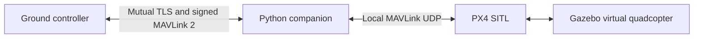

# px4-drone-identity-sitl

I built a simulated drone with a controller identity check to learn how the underlying idea works. This is a learning project.

## Fly it locally

I run the full simulation on Linux. The [setup guide](docs/running.md) includes a pinned container environment and the exact build commands. After building PX4 v1.16.0, I can run the same automated flight checks:

```sh
python scripts/sitl_check.py --px4 /path/to/PX4-Autopilot
```

For an interactive run, start the simulator with the parameters in the setup guide, then use three terminals with the virtual environment activated:

```sh
# Once: creates temporary local certificates, never committed.
drone-identity provision
# Terminal 1: leave the companion running.
drone-identity companion
# Terminal 2: connect, fly to two metres, land and disarm.
drone-identity fly
```

I stop the companion and simulator with Ctrl+C when finished. The automated runner stops its own simulator even if a test fails.

## What I let the controller do

I give one controller permission to arm normally, enter external control, request a landing, and send position targets within ten metres horizontally and five metres above the starting point. External control, called **Offboard mode**, requires a continuing stream of targets. I reject other commands, including parameter changes and forced arming. A second connection cannot take over an active session.

I use mutual TLS, an encrypted connection that checks certificates at both ends, to establish identity. The companion checks the controller's certificate against an explicit permission list and sends it a fresh, temporary signing key. Both programs use `pymavlink` to sign and verify MAVLink 2, the message format used by the flight software. Replayed, unsigned or incorrectly signed control messages close the session. Only a verified controller heartbeat keeps its permission alive.

## Architecture and limits



The companion is the authentication boundary. Its outgoing PX4 packets also contain MAVLink 2 signatures, but the pinned PX4 v1.16.0 build does **not** enforce those signatures. The simulator's UDP ports must stay on a trusted local machine or isolated container network. Direct access to those ports bypasses the companion. I have not built a secure radio link or a production flight-security system.

If a session fails, the companion stops forwarding targets; it never keeps flying from a cached target. PX4 independently detects the missing Offboard stream and selects its configured Land action. This also covers a crashed companion. Certificate provisioning is a disposable local demonstration, with short-lived certificates and no stored certificate-authority private key. [Design details](docs/design.md) explain the protocol, trust boundary and remaining limits.

## Tests and limits

There are 2 test source files in this copy. That source count does not establish an execution result. This is a source snapshot, and running it on a new machine may need environment-specific setup.


The relocated workflow did not complete successfully within the migration batch. Local test sources remain available.

No project-specific GitHub Actions workflow was retained. The local test sources remain in this folder.
