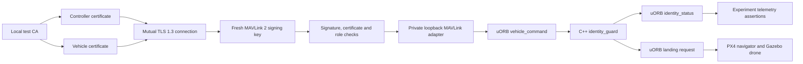

# Architecture

I split identity checking from flight control so that PX4 can still react if the Python process stops.

## Identities and software keys

`identity.py` creates a new local Ed25519 CA and separate vehicle, pilot, observer and deliberately expired test identities. The CA has certificate-signing key usage and a seven-day lifetime. Leaf certificates have client or server extended key usage, a CA-signed role in the organizational-unit field, and two-day lifetimes. The vehicle certificate names `localhost`. Private directories are mode 0700 and files are mode 0600. Provisioning refuses a nonempty directory. Experiments generate a fresh store in a temporary directory and delete it even on failure.

`KeyStore` is the secure-element-style boundary: `certificate()`, `sign(challenge)` and `tls_context(ca_file, server=...)`. `SoftwareKeyStore` implements it with PEM files. The challenge test proves possession with a real Ed25519 signature. Runtime possession is proved by OpenSSL's TLS handshake using the same key. There is no private-key getter in the interface, but the implementation and TLS library necessarily read keys into RAM. A hardware replacement would require an OpenSSL provider or PKCS#11 integration. Merely changing the class does not make Python's TLS hardware-backed.

`revoked.json` is a local administrative denylist of certificate serial numbers, atomically replaced by the revoke operation. It is not a distributed, signed CRL or an OCSP service. Its directory is trusted control-plane storage. Missing or malformed revocation data fails closed. Certificate issuer, validity, purpose and role are checked independently of TLS and rechecked on every accepted-session frame, so an already-open TLS session does not retain permission after revocation or expiry.

## Session and wire format

1. The gateway requires a trusted client certificate over TLS 1.3. The client verifies the vehicle CA, hostname, validity, role and revocation state.
2. Only one authenticated session occupies the flight gateway. Up to eight handshake/session workers are bounded; a second valid session receives no signing key while the slot is busy.
3. The vehicle must be disarmed with fresh telemetry before starting a session. The companion resets the module and waits for the reset to appear in telemetry.
4. The server generates 32 random bytes per session and sends them inside TLS. They are not persisted or logged. Reconnecting creates a different key, so an old-session frame cannot authenticate.
5. Each payload has a two-byte big-endian length, then exactly one signed MAVLink 2 frame. Frames must come from controller system 42, component 190, signing link 1. Only HEARTBEAT and COMMAND_LONG are decoded. Unknown IDs, extra frames, malformed lengths, unsigned frames and unsupported flags are denied.
6. `pymavlink` verifies the MAVLink CRC, six-byte SHA-256 authenticator and strictly increasing signing timestamps. Its receiver state lives for the whole session. No unsigned-accept callback is installed. All controller sends serialize encoding and transport to keep timestamps in wire order.
7. The gateway rechecks identity and command policy before forwarding. A rejection closes and latches that session; another valid packet cannot undo it. The private adapter also latches on any rejection or failed module status, checks its own accepted-heartbeat deadline and refuses commands without fresh active module telemetry. This prevents an old session from resuming before the PX4 status stream catches up. Responses are bounded JSON containing acceptance or rejection and observed telemetry. “Accepted” means accepted by the gateway, not proof that PX4 executed a flight command; the experiment waits for actual flight state.

MAVLink signing does not encrypt a message. TLS supplies transport encryption in this lab. Ed25519 authenticates the certificates/TLS handshake, not the MAVLink frames themselves.

## Roles and command adapter

| Role | Allowed signed messages |
| --- | --- |
| Observer | Heartbeat/status only |
| Pilot | Heartbeat, arm/disarm (400), takeoff (22), land (21) |

Commands must target system 1/component 1, confirmation zero, with no force-arm options or extra parameters. Takeoff uses a lab-specific bounded relative height of 1–5 metres in parameter 7. The private adapter converts it to PX4's sea-level altitude using fresh GLOBAL_POSITION_INT telemetry, and sets latitude/longitude to NaN to retain the current location. It refuses takeoff without that fresh measurement. It similarly requests landing at the current position. This translation is why forwarding is a trusted boundary rather than an end-to-end signature from controller to PX4.

The local adapter uses system 42/component 191. USER_1 (31000) is an internal lab signal: parameter 1 is pulse (1), reject (2), or reset (3); parameter 2 is the rejection reason. It is not accessible through the external allowlist. UDP 14580 and the companion's receiver 14540 stay inside the container. The startup script creates no normal public GCS, camera or gimbal MAVLink endpoints. A small source patch changes the lab PX4 UDP listener from INADDR_ANY to INADDR_LOOPBACK. The campaign checks the actual Linux socket table before flying; setting a loopback destination alone would not restrict who could send to it. Do not publish those UDP ports or use host networking.

## PX4 module

`identity_guard.cpp` subscribes to uORB `vehicle_command` and `vehicle_status`. `guard.hpp` is the same state machine used in the native C++ regression test. It publishes `IdentityStatus.msg` as `identity_status`, including timestamp, last authenticated heartbeat, state, reason and armed state. It also publishes `debug_key_value` under `id_guard`, which PX4's existing NAMED_VALUE_FLOAT stream exposes to the experiment.

| State | Meaning | Transition |
| --- | --- | --- |
| 0 | Idle | Accepted heartbeat activates it |
| 1 | Authenticated | More than 2 seconds without accepted heartbeat, or rejection, latches state 2 |
| 2 | Failsafe | Accepted heartbeat cannot clear it; reset only works when disarmed |

The telemetry value is `state * 10 + reason`. Active is 10. Failsafe reasons are timeout 1, identity 2, frame/signature/replay 3, role/policy 4, disconnect 5. The first reason stays latched. While armed in state 2, the module publishes a NAV_LAND vehicle command once per second. It does not cut the motors in flight. PX4 performs landing and automatically disarms after ground contact. This is an application watchdog requesting a PX4 navigation action, not a change to PX4's built-in failsafe flag.

The startup configuration disables the normal GCS-loss action for these experiments so it cannot conceal a broken identity watchdog. The telemetry receiver's internal GCS heartbeat also cannot renew the identity watchdog; only accepted controller heartbeats generate its pulse.

## Reproducibility and ownership

The Docker image checks PX4 v1.16.0 at `6ea3539157ca358c70a515878b77077af7d4611d`. Gazebo Harmonic is installed by that release's Ubuntu setup script; its models are the PX4 submodule revision. Python runtime dependencies are pinned in `pyproject.toml`. Ubuntu package repositories remain moving inputs, so this is source-pinned rather than bit-for-bit reproducible.

`Simulator` starts one new process group, records its PID, start time, UDP port and scoped cleanup command, and terminates that group in a finally path. It keeps its owned stdin pipe open so unattended PX4 does not spin on EOF. A joined reader drains output in fixed-size chunks and caps the log at 10 MiB, recording truncation rather than growing a diagnostic buffer. Cleanup verifies remaining live members and port release. The gateway owns and closes its listener, accepted sockets and threads; the UDP receiver and controller heartbeat threads have joined cleanup paths. No browser, host server or host port mapping is needed.

References I used: [PX4 Gazebo simulation](https://docs.px4.io/v1.16/en/sim_gazebo_gz/), [PX4 uORB](https://docs.px4.io/v1.16/en/middleware/uorb), and [MAVLink message signing](https://mavlink.io/en/guide/message_signing.html).
